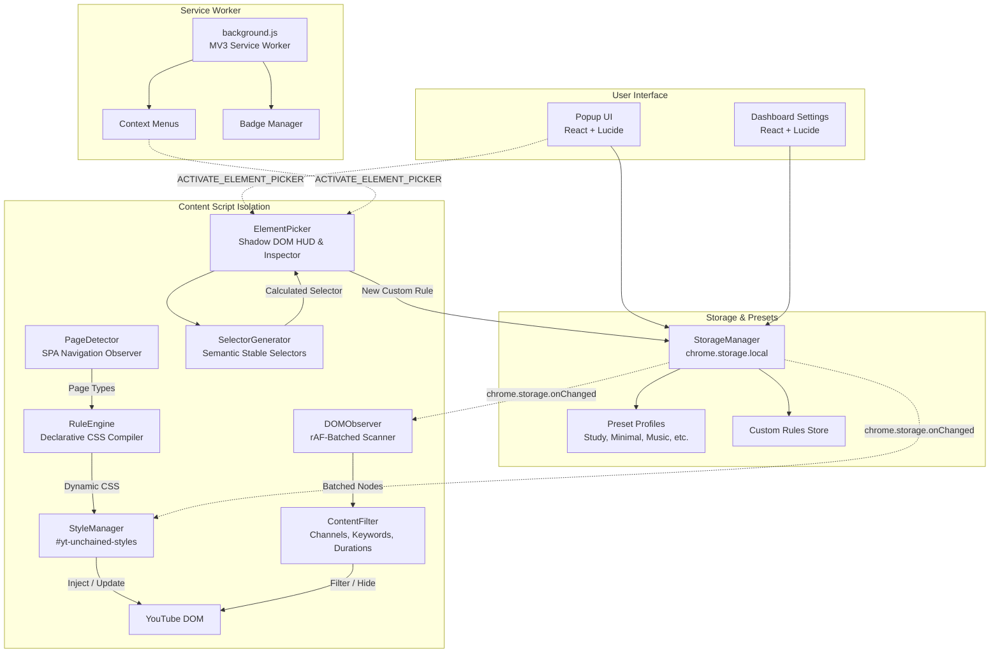

# YouTube Unchained: Technical Architecture & System Design

**Project:** YouTube Unchained  
**Target Platform:** Chromium-based browsers (Vivaldi, Google Chrome, Brave, Edge)  
**Standard:** Manifest V3 (MV3)  
**Core Technologies:** TypeScript 5.7 (Strict), React 18, Vite 6, Vitest 3  

---

## 1. Architectural Overview & Philosophy

YouTube Unchained is engineered around a core tenet:
> *"YouTube should look and behave the way the user wants, not the way YouTube dictates."*

Unlike legacy browser extensions that rely on hundreds of thousands of lines of monolithic procedural JavaScript or heavy jQuery injections, YouTube Unchained employs a **declarative, decoupled rule engine** backed by a **zero-latency dynamic stylesheet injector** and a **batched, non-blocking DOM mutation observer**.



---

## 2. Layered Module Breakdown

### 2.1 Settings & Storage Layer (`src/shared/`)
* **`defaults.ts`**: Provides immutable baseline structures for `UserSettings`, default visibility toggles, layout parameters, and 6 built-in presets (`Default`, `Study Mode`, `Minimal Mode`, `Music Mode`, `Subscription Mode`, `Distraction-Free`).
* **`storage.ts` (`StorageManager`)**:
  - Interacts exclusively with `chrome.storage.local`.
  - Implements automatic forward schema migration (`migrate(raw)`).
  - Guarantees preset switching is non-destructive: switching presets swaps active visibility and layout parameters while preserving the user's custom element rules intact.
  - Implements schema validation for export and import, catching corrupt or malformed payloads before applying them.

### 2.2 Rule Engine & Style Generator (`src/engine/RuleEngine.ts` & `StyleManager.ts`)
* **Zero-FOUC (Flash of Unstyled Content):** Injected at `document_start` before YouTube's scripts or DOM nodes render.
* **Declarative CSS Compilation:** Transforms boolean settings and custom rules into pure, browser-native CSS rules.
* **Root Attribute Synchronization:** Binds `document.documentElement.setAttribute('yt-unchained-active', 'true')` and `[yt-unchained-page="..."]`.
* **Native YouTube Grid Overrides:** Instead of brittle JavaScript layout re-calculations, YouTube Unchained overrides YouTube's internal layout custom properties:
  ```css
  ytd-rich-grid-renderer {
    --ytd-rich-grid-items-per-row: 4 !important;
    --ytd-rich-grid-item-margin: 8px !important;
  }
  ```

### 2.3 Single Page Application (SPA) Lifecycle (`src/engine/PageDetector.ts`)
YouTube does not reload pages between navigation; it swaps views client-side using Polymer/Wiz routers.
* YouTube Unchained listens to:
  1. `yt-navigate-finish` (fired on YouTube window when SPA transition completes).
  2. `yt-page-data-updated` (fired when new video player or feed data lands).
  3. `popstate` (standard browser back/forward).
  4. Lightweight body mutation watcher fallback.
* Classifies URL into distinct semantic page types: `home`, `watch`, `results`, `channel`, `subscriptions`, `shorts`, `playlist`.
* Immediately updates root attribute `yt-unchained-page` so page-scoped rules take effect instantly without rebuilding the DOM.

### 2.4 Content Filtering Engine (`src/filters/ContentFilter.ts`)
* **Channel Filtering:** Matches channel author against user blocklist with support for `contains` (substring) or `exact` match types (case-insensitive).
* **Title Keyword Filtering:** Matches video title against user keyword strings or full Regular Expressions with safe error boundaries.
* **Duration Threshold Filtering:** Parses YouTube timestamp badge strings (`HH:MM:SS` or `MM:SS`) into numeric seconds. Filters videos shorter than minimum or longer than maximum bounds.
* **Watched Video Filtering:** Detects watch history playback progress indicators (`ytd-thumbnail-overlay-resume-playback-renderer`).
* **Search Shelf Cleaning:** On `/results`, strips recommendation carousels (`ytd-shelf-renderer`, `ytd-horizontal-card-list-renderer`) such as "People also watched" and "For you".

### 2.5 Batched, Non-Blocking DOM Observer (`src/engine/DOMObserver.ts`)
To prevent scroll lag, infinite mutation loops, and layout thrashing:
* Restricts observation target to `<ytd-app>` (or body), filtering out mutations triggered by our own stylesheet or element picker.
* Gathers newly appended video cards into a `Set<HTMLElement>`.
* Defers processing to the next browser animation frame using `requestAnimationFrame`.
* Idempotent: Marks filtered elements with `data-yt-unchained-filtered="reason"` and sets `display: none !important`.

### 2.6 Visual Element Picker & Selector Generator (`src/picker/`)
* **Closed Shadow DOM Isolation (`<div id="yt-unchained-picker-root">`):**
  - Completely isolates picker HUD, tooltip, and modal styling from YouTube's aggressive global styles.
  - Ensures picker CSS never bleeds into YouTube.
* **Smart Selector Generator (`SelectorGenerator.ts`):**
  - **Level 1:** Checks for stable, semantic IDs (discarding volatile numeric or hash IDs).
  - **Level 2:** Evaluates semantic attributes (`[target-id="..."]`, `[aria-label="..."]`, `[title="..."]`).
  - **Level 3:** Contextual YouTube custom element tags (`ytd-*`, `yt-*`).
  - **Level 4:** Clean hierarchical paths avoiding fragile deep `:nth-child` chains.
  - Safely escapes all special characters with `escapeCss`.
* **Action Modal:** Allows users to pick "Hide completely" or "Collapse", scope to "Current page only" or "All YouTube pages", and provide a user-friendly name.

---

## 3. Security & Privacy Guarantees

1. **Zero External Calls:** YouTube Unchained requires NO remote servers, analytics, or third-party APIs. All processing runs 100% locally in the browser.
2. **Least-Privilege Permissions:**
   - `storage`: For storing user configuration.
   - `contextMenus`: For "Customize this element" right-click shortcut.
   - `host_permissions`: Strictly limited to `*://*.youtube.com/*`.
3. **No Arbitrary Code Execution:** Custom rules only accept CSS selectors and style declarations. Evaluated code (`eval`, `new Function`) is strictly disallowed.
4. **Data Integrity:** Imported JSON configurations are validated against schema boundaries before persistence.
